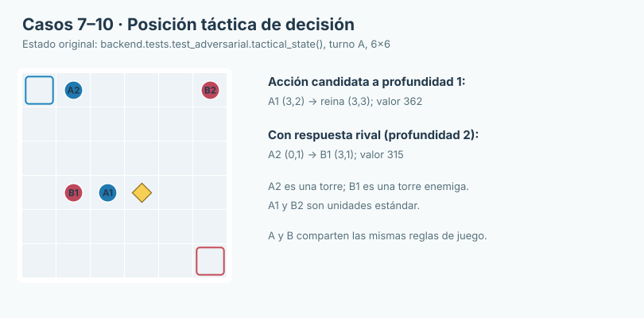
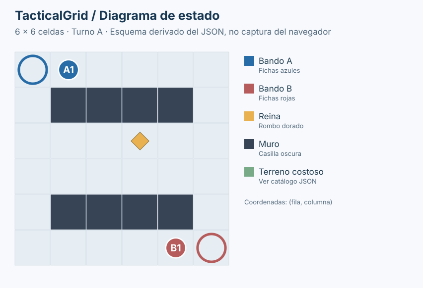
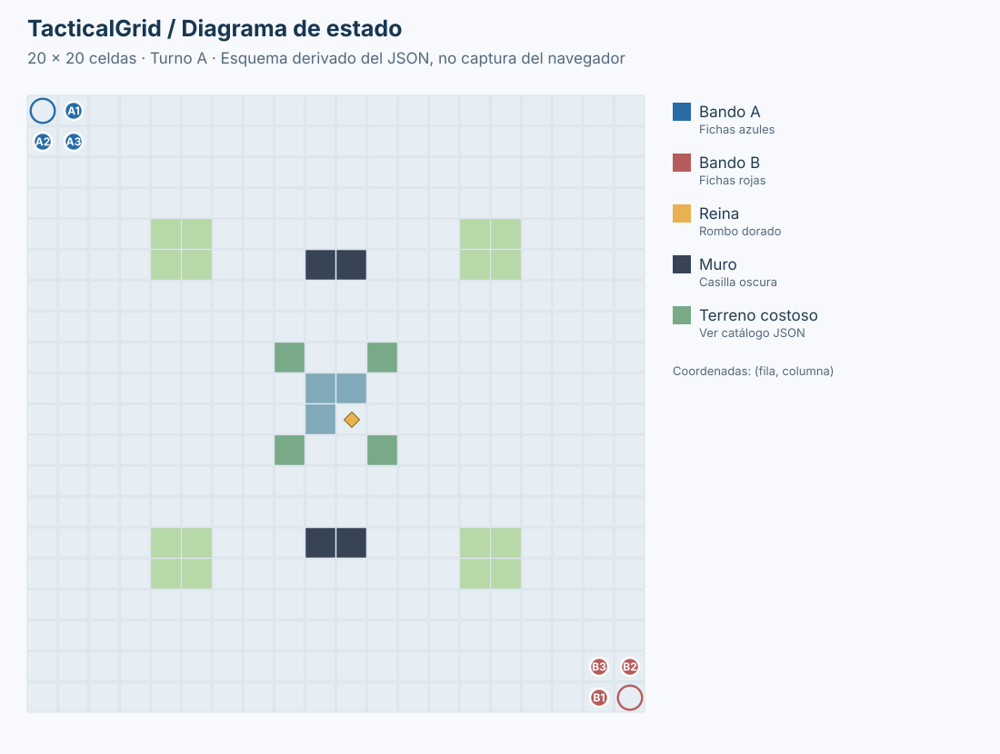

# Experimentos de decisión adversarial: Minimax y alfa-beta

**Juan Camilo Cruz Parra · Sistemas Inteligentes I**  
**Casos 7–10 de TacticalGrid · Octubre de 2026**

## 1. El escenario exacto utilizado

Los resultados comparativos de este documento proceden de la función **`tactical_state()`** definida en `backend/tests/test_adversarial.py` y de las mediciones almacenadas en `outputs/adversarial_comparacion.json`. Se eligió un escenario **6×6** porque permite interpretar las decisiones y explorar hasta profundidad 4 con tiempos reproducibles. No corresponde al escenario externo 20×20.



*Figura 1. Tablero del experimento. Juega A. `A1 estandar` parte de (3,2) y está junto a la reina de (3,3); `A2 rook` parte de (0,1); `B1 rook` ocupa (3,1); `B2 estandar` ocupa (0,5). Las bases están en (0,0) y (5,5).* 

Los algoritmos obtienen todas las acciones legales de `action_successors`. La evaluación es la misma para Minimax y alfa-beta; el algoritmo no usa una regla especial para la torre enemiga. La profundidad indica el número máximo de acciones alternadas consideradas. Los resultados numéricos son **utilidades relativas** para el bando MAX, no porcentajes de victoria.

## 2. Caso 7 — Avanzar hacia la reina puede ser un error táctico

**Pregunta experimental:** ¿cambia la acción cuando el algoritmo considera también la reacción del rival?

| Horizonte | Acción recomendada | Valor | Hojas evaluadas |
|---|---|---:|---:|
| Minimax d=1 | `A1 → (3,3)` | 362 | 12 |
| Minimax d=2 | `A2 → (3,1)` | 315 | 92 |

Con profundidad 1 se favorece aproximar A1 a la reina. Al incorporar una respuesta enemiga, la torre A2 captura a B1: el valor del estado se evalúa considerando una posible réplica y se evita una amenaza. **No se comparan directamente los valores 362 y 315 para decidir qué horizonte es «mejor»**, porque corresponden a árboles diferentes. Sí se constata un cambio de acción.

## 3. Caso 8 — Alfa-beta conserva Minimax

**Pregunta:** ¿se obtiene la misma acción y utilidad con menos evaluaciones, manteniendo el estado, profundidad y función de utilidad?

| Algoritmo (d=3) | Acción | Utilidad | Generados | Hojas evaluadas | Ramas hermanas podadas |
|---|---|---:|---:|---:|---:|
| Minimax | `A2 → (3,1)` | 845 | 1198 | 1094 | 0 |
| Alfa-beta | `A2 → (3,1)` | 845 | 706 | 328 | 314 |

**Resultado:** ambos eligen la misma captura, con valor **845**. Alfa-beta materializó menos sucesores y evaluó menos hojas. El corte sucede cuando `alfa ≥ beta`, de modo que una rama que no cambia la decisión de un antecesor deja de explorarse. Esto es una optimización de Minimax, no otro criterio de valoración.

## 4. Caso 9 — El orden modifica la eficiencia de la poda

**Pregunta:** ¿qué cambia si se recorre el mismo conjunto de acciones en orden inverso?

| Orden alfa-beta (d=3) | Acción | Valor | Generados | Hojas | Podas | Tiempo |
|---|---|---:|---:|---:|---:|---:|
| Normal | `A2 → (3,1)` | 845 | 706 | 328 | 314 | ≈0,127 s |
| Inverso | `A2 → (3,1)` | 845 | 385 | 204 | 146 | ≈0,067 s |

**Resultado:** el orden inverso evaluó menos hojas en esta posición; la acción y la valoración no cambiaron. Aunque su contador de podas es menor, las ramas que se evitan en niveles superiores pueden representar muchos descendientes. `nodes_pruned` registra únicamente los sucesores directos omitidos tras el corte, no el tamaño potencial de sus subárboles.

## 5. Caso 10 — Profundidad, costo de cómputo y cambio de plan

| Minimax | Acción | Utilidad | Hojas evaluadas | Tiempo |
|---|---|---:|---:|---:|
| d=1 | `A1 → (3,3)` | 362 | 12 | ≈0,003 s |
| d=2 | `A2 → (3,1)` | 315 | 92 | ≈0,026 s |
| d=3 | `A2 → (3,1)` | 845 | 1094 | ≈0,265 s |
| d=4 | `A2 → (3,1)` | 820 | 11115 | ≈2,689 s |

El salto entre d=1 y d=2 cambia la elección. Entre d=3 y d=4 se mantiene la captura, pero se multiplican las evaluaciones de hojas. **Un horizonte mayor puede cambiar el valor en cualquier sentido**, porque aparecen respuestas futuras del enemigo. No implica que cada acción automática vaya a acercarse a una victoria.

## 6. Evaluación del comportamiento en partidas

Se efectuaron además simulaciones de turnos consecutivos con alfa-beta d=2:



*Figura 2. `scenarios/partida/mapa_partida_presentacion.json`, 6×6, una unidad estándar por bando, reina en (2,3). Registro: `outputs/demo_partida_6x6.json`.*

**Resultado:** el motor declaró victoria para B después de **24 acciones**.



*Figura 3. `scenarios/adversarial/externo_adversarial_3v3.json`, utilizado como estado inicial de una simulación de partida; tres unidades estándar por bando y reina en (10,10). Registro: `outputs/demo_adversarial_20x20.json`.*

**Resultado:** después de **105 acciones** un detector del programa de simulación identificó la repetición de un estado. El **motor no declaró vencedor ni empate**; la repetición es una limitación estratégica observada, no una regla nueva del juego.

## 7. Cómo reproducir y qué significa cada métrica

Los casos 7–10 utilizan el estado de prueba `tactical_state()`; por ello deben ejecutarse desde las pruebas automatizadas o mediante una carga JSON equivalente **que reproduzca exactamente ese estado**, no sustituyéndolo por cualquiera de los escenarios 20×20. Para repetir la comparación desde la raíz:

```bash
python -m unittest backend.tests.test_adversarial -v
```

Los resultados detallados se conservan en `outputs/adversarial_comparacion.json`. Para las partidas consecutivas:

```bash
python -m scripts.self_play scenarios/partida/mapa_partida_presentacion.json --depth 2 --max-turns 40
python -m scripts.self_play scenarios/adversarial/externo_adversarial_3v3.json --depth 2 --max-turns 120
```

`nodes_generated` registra hijos legales construidos; `nodes_evaluated`, hojas donde se invocó la utilidad; `nodes_pruned`, ramas hermanas que un corte evita explorar; `elapsed_seconds`, tiempo medido. Las cifras no son límites de complejidad ni garantizan que alfa-beta siempre sea más rápido. La función de utilidad y sus pesos concretos se presentan en el **Documento técnico**.