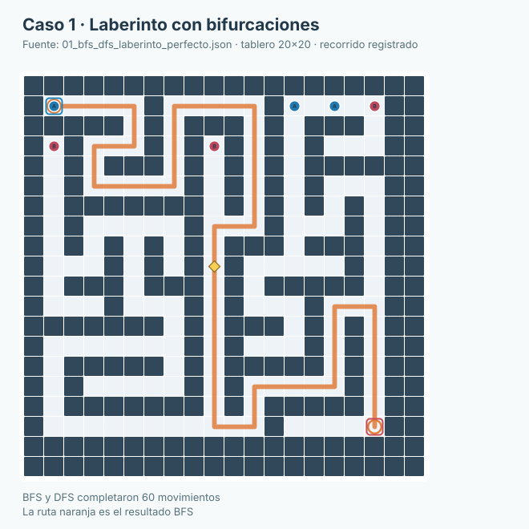
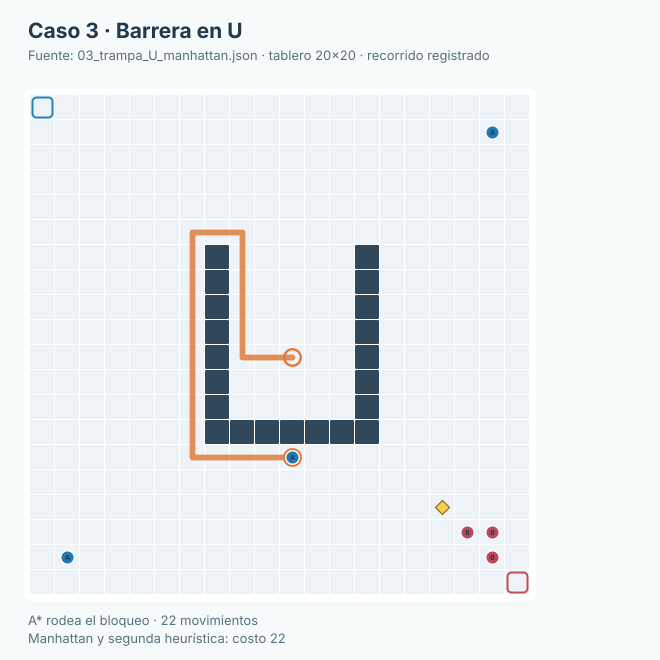
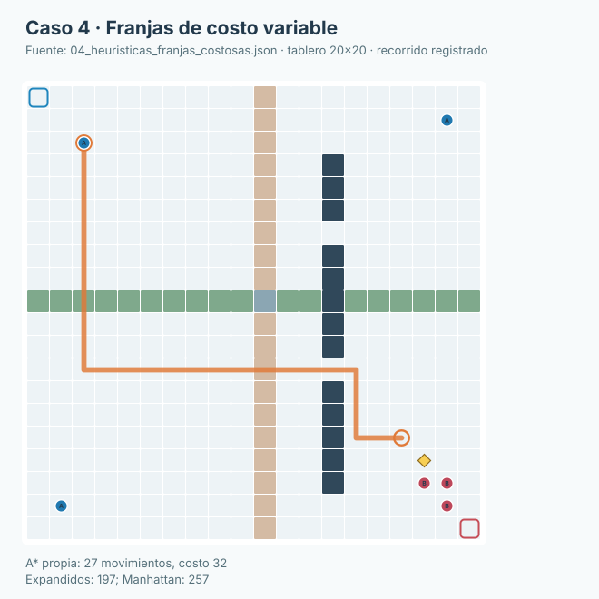
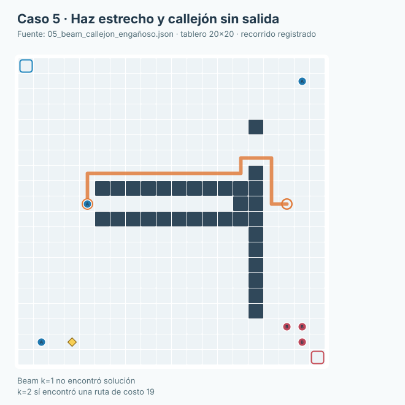
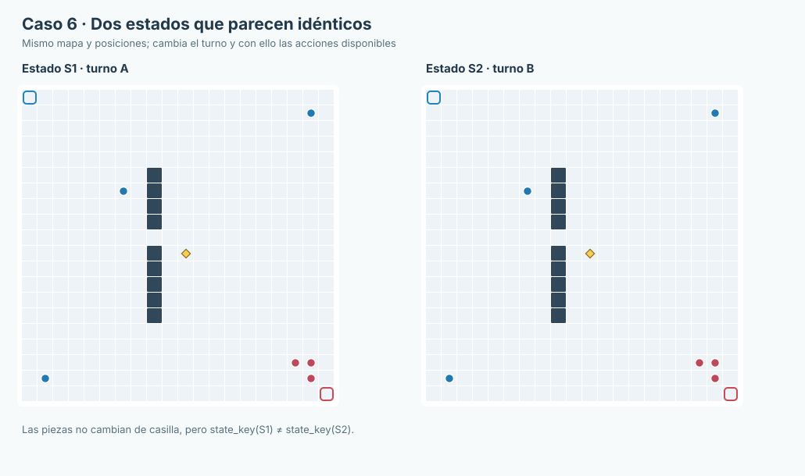
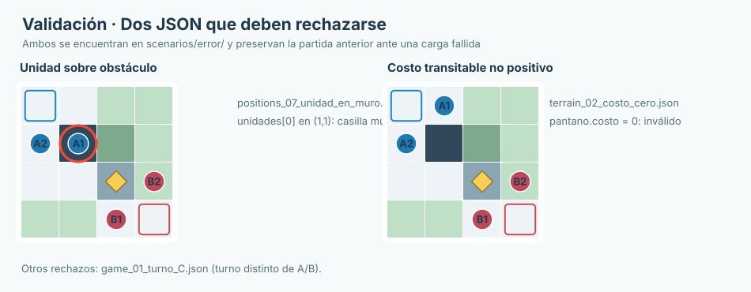

# Informe de verificación y resultados experimentales

**Juan Camilo Cruz Parra · Sistemas Inteligentes I**  
**TacticalGrid · 21 de octubre de 2026**

## 1. Método experimental

Se empleó la implementación Python de TacticalGrid, con escenarios JSON externos almacenados en `scenarios/`. Las búsquedas se ejecutaron sobre copias del mismo estado inicial; para comparar algoritmos se mantuvieron constantes la unidad, el objetivo y el mapa. Los registros detallados de navegación están en `outputs/busqueda_comparacion_real.json` y los de decisión en `outputs/adversarial_comparacion.json`.

El entorno de referencia utilizó **Linux y Python 3.13.5**. La batería `python -m unittest discover -s backend/tests -t . -v` finalizó con **177 pruebas aprobadas**. La API respondió correctamente a `GET /api/state`. Los tiempos que aparecen son mediciones observadas de esa ejecución y pueden variar en otros equipos; no son promedios de múltiples repeticiones.

**Convención:** coordenadas `(fila, columna)` desde 0, casillas oscuras como obstáculos, fichas azules del bando A, rojas del B, reina como rombo amarillo. Los diagramas se obtuvieron de las matrices de los escenarios; las líneas resaltadas siguen las rutas registradas por los algoritmos, no rutas dibujadas manualmente.

## 2. Caso 1 — BFS y DFS: laberinto

**Escenario:** `scenarios/busqueda/01_bfs_dfs_laberinto_perfecto.json`, tablero 20×20, unidad `A_ES` de tipo `estandar`, origen `(1,1)` y objetivo `(17,17)`. El corredor disponible contiene numerosos giros y bifurcaciones; los demás personajes permanecen como entorno.



*Figura 1. Laberinto real. La línea naranja corresponde al camino encontrado por BFS; DFS también llegó al objetivo con 60 movimientos en esta instancia.*

| Algoritmo | Movimientos | Costo | Estados generados | Expandidos | Frontera máxima |
|---|---:|---:|---:|---:|---:|
| BFS | 60 | 60 | 129 | 124 | 5 |
| DFS | 60 | 60 | 184 | 183 | 5 |

**Qué se demuestra:** ambos alcanzan una meta válida, pero sus estrategias de exploración son distintas. BFS encuentra un mínimo de **movimientos** en grafos no ponderados; DFS no ofrece esa garantía. En **este** laberinto ambos obtuvieron longitud 60; no sería correcto afirmar que DFS produjo una ruta mayor.

## 3. Caso 2 — BFS y UCS: la ruta corta no es la barata

**Escenario:** `scenarios/busqueda/02_bfs_ucs_dos_corredores.json`, tablero 20×20, misma unidad inicial `A_ES` y objetivo configurado por `prueba`. El terreno contiene caminos alternativos de costos diferentes, incluido terreno de alto precio.


*Figura 2. Izquierda: resultado BFS, corredor de menos acciones. Derecha: resultado UCS, rodeo de menor costo. Las líneas representan las rutas reales guardadas en el registro.*

| Algoritmo | Movimientos | Costo total | Generados | Expandidos |
|---|---:|---:|---:|---:|
| BFS | 10 | 64 | 173 | 152 |
| UCS | 12 | 12 | 201 | 174 |

**Interpretación:** BFS utiliza dos acciones menos, pero el costo de terreno de su recorrido es significativamente mayor. UCS prioriza `g(n)`, el costo acumulado, y obtiene una ruta de costo 12. Las dos soluciones se pueden verificar recorriendo sus movimientos y sumando los costos definidos en el JSON.

## 4. Caso 3 — Barrera en U y estimación geométrica

**Escenario:** `scenarios/busqueda/03_trampa_U_manhattan.json`, tablero 20×20, unidad `A_ES` en `(14,10)` y objetivo `(10,10)`. Aunque la meta parece estar a pocas filas, un obstáculo en forma de U obliga a rodear.



*Figura 3. El recorrido destacado atraviesa el corredor disponible; un desplazamiento directo hacia arriba no llega a la meta.*

A* con Manhattan y A* con la segunda heurística encontraron **22 movimientos, costo 22**, con **307 estados generados y 245 expandidos** en ambos casos. En este mapa **no se registró ahorro de estados** entre heurísticas. El caso muestra por qué cercanía geométrica y accesibilidad real son conceptos distintos.

## 5. Caso 4 — Dos heurísticas de A* en terreno ponderado

**Escenario:** `scenarios/busqueda/04_heuristicas_franjas_costosas.json`, tablero 20×20, unidad y meta definidas en `prueba`. Incluye franjas de terreno con costos distintos para que las heurísticas ordenen la exploración de forma diferente.



*Figura 4. Ruta seleccionada por A* con la segunda heurística; ambos métodos llegaron a costo 32.*

| Heurística | Movimientos | Costo | Generados | Expandidos | Frontera máxima |
|---|---:|---:|---:|---:|---:|
| Manhattan | 27 | 32 | 303 | 257 | 60 |
| Segunda heurística | 27 | 32 | 254 | 197 | 68 |

**Interpretación:** la segunda heurística redujo los expandidos de 257 a 197 **en este escenario**, aunque alcanzó una frontera máxima mayor. Una menor expansión no garantiza una mejora universal ni necesariamente menor memoria. El fundamento matemático de ambas estimaciones se desarrolla en el documento técnico.

## 6. Caso 5 — Beam Search y pérdida de alternativas

**Escenario:** `scenarios/busqueda/05_beam_callejon_engañoso.json`, tablero 20×20, unidad `estandar` con objetivo configurado en el JSON. Una decisión que parece buena localmente introduce una ruta sin continuación.



*Figura 5. Ruta encontrada con k=2. Beam con k=1 descartó la alternativa útil y no encontró solución.*

| Ancho `k` | ¿Encontró ruta? | Movimientos | Costo | Generados | Frontera máxima |
|---:|---|---:|---:|---:|---:|
| 1 | No | — | — | 13 | 1 |
| 2 | Sí | 19 | 19 | 59 | 2 |
| 4 | Sí | 19 | 19 | 112 | 4 |
| 8 | Sí | 19 | 19 | 180 | 8 |

**Qué se demuestra:** Beam reduce la frontera conservando solamente `k` candidatos por nivel. Con `k=1`, una elección local descarta la ruta útil. Aumentar `k` permite resolver esta instancia, pero implica explorar y conservar más estados.

## 7. Caso 6 — El estado incluye más que posiciones

**Escenarios:** `scenarios/adversarial/06_estado_compuesto_turno_A.json` y `scenarios/adversarial/06_estado_compuesto_turno_B.json`. Ambos presentan el mismo tablero 20×20 y la misma distribución inicial de unidades, pero el turno pertenece a bandos distintos.



*Figura 6. A la izquierda juega A; a la derecha juega B. Aunque las fichas están en las mismas casillas, las acciones disponibles y la clave del estado no coinciden.*

La prueba automatizada comprueba `state_key(estado_A) != state_key(estado_B)`. El motor también distingue ubicación y portador de reina, actividad de unidades, reyes y resultado. Reducir el estado únicamente a las posiciones produciría falsas equivalencias.

## 8. Casos 7–10 — Minimax, alfa-beta, orden y profundidad

**Escenario efectivamente medido:** `tactical_state()` de `backend/tests/test_adversarial.py`, **no** el escenario JSON 20×20. Esta función construye un tablero 6×6 con turno A, reina libre en `(3,3)`, `A1 estandar` en `(3,2)`, `A2 rook` en `(0,1)`, `B1 rook` en `(3,1)` y `B2 estandar` en `(0,5)`.


*Figura 7. El objetivo está junto a A1, pero B1 puede intervenir. Capturar con A2 se vuelve preferible cuando Minimax considera la respuesta del rival.*

| Prueba | Método / condición | Acción | Valor | Hojas evaluadas | Podas |
|---|---|---|---:|---:|---:|
| 7 | Minimax, profundidad 1 | A1 → (3,3) | 362 | 12 | 0 |
| 7 | Minimax, profundidad 2 | A2 → (3,1) | 315 | 92 | 0 |
| 8 | Minimax, profundidad 3 | A2 → (3,1) | 845 | 1094 | 0 |
| 8 | Alfa-beta, profundidad 3 | A2 → (3,1) | 845 | 328 | 314 |
| 9 | Alfa-beta inverso, profundidad 3 | A2 → (3,1) | 845 | 204 | 146 |
| 10 | Minimax, profundidad 4 | A2 → (3,1) | 820 | 11115 | 0 |

**Caso 7:** al prever una respuesta enemiga, se prefiere capturar a B1 con A2. **Caso 8:** la igualdad de acción y valor demuestra que la poda no alteró la decisión medida. **Caso 9:** invertir el orden cambió las hojas evaluadas; `nodes_pruned` cuenta hermanos omitidos, no todos los descendientes hipotéticos. **Caso 10:** aumentar profundidad elevó sustancialmente el trabajo y no elevó necesariamente el valor de utilidad. Véase **Experimentos adversariales** para explicación paso a paso.

## 9. Validación de escenarios JSON: ejemplos reproducibles

La importación debe rechazar escenarios inconsistentes sin sustituir el estado oficial cargado. Para comprobarlo se cargó un estado válido y después se ensayaron archivos de `scenarios/error/`.



*Figura 8. Izquierda: una unidad inicial coincide con un muro. Derecha: un terreno transitable declara costo cero. Ambas entradas son inválidas por razones distintas.*

| Archivo | Invariante infringida | Mensaje relevante de validación |
|---|---|---|
| `positions_07_unidad_en_muro.json` | Unidad en obstáculo | `unidades[0]: la posición (1, 1) está sobre un obstáculo` |
| `terrain_02_costo_cero.json` | Terreno transitable con costo no positivo | `tipos_terreno.pantano.costo: debe ser un número positivo para terreno transitable` |
| `game_01_turno_C.json` | Turno distinto de A y B | `turno: debe ser 'A' o 'B'` |

Las tres respuestas anteriores fueron obtenidas con `prepare_scenario` sobre los JSON indicados. Las pruebas HTTP cubren además la **atomicidad** de la carga: si se rechaza una importación, `/api/state` conserva el escenario anterior. No se debe inferir que basta con rechazar un JSON para garantizar la atomicidad; esta se verifica comparando el estado antes y después.

## 10. Partidas de prueba y sus límites


*Figura 9. Estado inicial de `scenarios/partida/mapa_partida_presentacion.json` utilizado en la simulación de partida completa.*

| Escenario | Algoritmo | Profundidad | Acciones | Condición observada | Ganador oficial |
|---|---|---:|---:|---|---|
| `mapa_partida_presentacion.json` (6×6) | Alfa-beta | 2 | 24 | Estado terminal del motor | B |
| `externo_adversarial_3v3.json` (20×20) | Alfa-beta | 2 | 105 | Repetición detectada por la simulación | Ninguno |


*Figura 10. Inicio del escenario 20×20 con tres unidades estándar por bando, costos mixtos y reina central. Para el ensayo de 105 acciones se usó en modo simulación de partida.*

Los registros completos contienen por turno acción, bando, evaluación, portador de la reina y resultado del motor: `outputs/demo_partida_6x6.json` y `outputs/demo_adversarial_20x20.json`. El ensayo 20×20 **no terminó oficialmente**. La detección de repetición corresponde a la herramienta de reproducción y no define una nueva regla de empate para TacticalGrid.

La simulación puede repetirse desde la raíz del proyecto:

```bash
python -m scripts.self_play scenarios/partida/mapa_partida_presentacion.json --depth 2 --max-turns 40
python -m scripts.self_play scenarios/adversarial/externo_adversarial_3v3.json --depth 2 --max-turns 120
```

## 11. Alcance de la validación

Los 177 casos automatizados comprueban invariantes, movimientos, costos, cargas, acciones HTTP, heurísticas, rutas, equivalencia adversarial y escenarios de regresión. Las pruebas no abarcan todos los estados posibles ni implican que Minimax juegue de manera óptima con una profundidad finita. Los ejemplos visualizados y sus archivos permiten verificar de forma independiente qué escenario produjo cada métrica, qué propiedad se probó y cuál fue el resultado real.