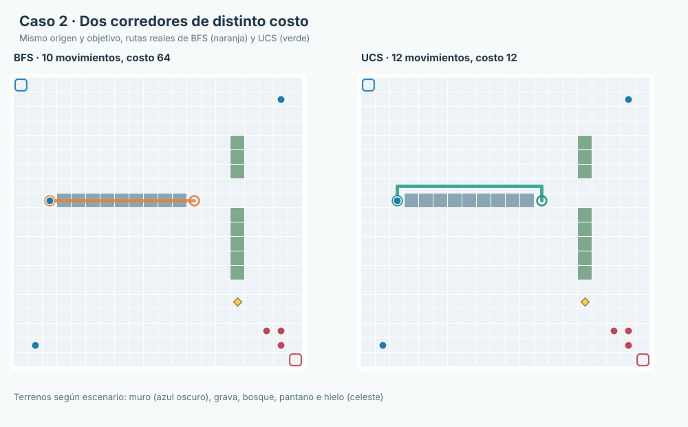

# Manual de usuario de TacticalGrid

**Juan Camilo Cruz Parra · Sistemas Inteligentes I**  
**Versión académica · Octubre de 2026**

TacticalGrid es un juego táctico por turnos y una herramienta para observar cómo trabajan algoritmos de búsqueda y decisión adversarial. Este manual permite instalarlo **desde un computador sin el proyecto configurado**, iniciar la interfaz y reproducir los experimentos incluidos. Los gráficos corresponden a escenarios JSON del programa.

## 1. Qué necesitas antes de comenzar

- Un computador con Windows 10/11, Linux o macOS y permisos para instalar Python.
- **Python 3.10 o posterior**, un navegador reciente (Chrome, Firefox o Edge) y conexión a Internet para cargar las bibliotecas visuales de Phaser y KaTeX.
- El código de [TacticalGrid en GitHub](https://github.com/Cruz1122/tactical-grid), descargado como ZIP o mediante Git.
- Una terminal: PowerShell en Windows, Terminal en macOS o la terminal de tu distribución Linux.

**El juego no requiere Node.js ni un servidor web adicional.** FastAPI sirve tanto la API como la interfaz desde el mismo puerto.

## 2. Instalar desde cero en Windows

### Paso 1. Instalar Python

Abre [python.org/downloads](https://www.python.org/downloads/) y descarga una versión compatible de Python. Ejecuta el instalador; habilita la opción que permite añadir Python al `PATH` cuando esté disponible. Al terminar, abre PowerShell y comprueba:

```powershell
py -3 --version
```

El resultado debe indicar Python 3.10 o superior. `py -3` selecciona la instalación de Python 3 registrada en Windows. Si no se reconoce, reinicia PowerShell después de instalar Python.

### Paso 2. Obtener el proyecto

Abre [github.com/Cruz1122/tactical-grid](https://github.com/Cruz1122/tactical-grid), pulsa **Code → Download ZIP**, descomprime el archivo y abre PowerShell dentro de la carpeta descomprimida. Por ejemplo:

```powershell
cd "$HOME\Downloads\tactical-grid-main"
```

El nombre de carpeta depende de la descarga. Debes ver `requirements.txt` y las carpetas `backend`, `frontend` y `scenarios`.

### Paso 3. Crear un entorno aislado

```powershell
py -3 -m venv .venv
```

Crea `.venv`, un entorno Python dedicado al proyecto. No es obligatorio activarlo: podemos llamar a su intérprete directamente y evitar problemas de políticas de ejecución de PowerShell.

### Paso 4. Instalar las dependencias

```powershell
.\.venv\Scripts\python.exe -m pip install -r requirements.txt
```

Este comando instala FastAPI, Uvicorn y las otras dependencias indicadas por el repositorio. Espera a que termine sin errores antes de continuar.

### Paso 5. Iniciar TacticalGrid

```powershell
.\.venv\Scripts\python.exe -m uvicorn backend.main:app --reload
```

Cuando la terminal anuncie que Uvicorn está escuchando, abre **http://127.0.0.1:8000** en el navegador. Para explorar las rutas de la API visita **http://127.0.0.1:8000/docs**. No cierres PowerShell mientras juegas; para detener el servidor pulsa **Ctrl+C**.

## 3. Instalar desde cero en Linux

### Paso 1. Instalar Python y su entorno virtual

Abre una terminal. Ejecuta **solo** el comando de tu distribución:

```bash
# Arch Linux / CachyOS
sudo pacman -S --needed python

# Debian / Ubuntu
sudo apt update && sudo apt install python3 python3-venv python3-pip

# Fedora
sudo dnf install python3 python3-pip
```

El gestor de paquetes descarga Python desde los repositorios de la distribución. Después comprueba `python3 --version`; debe ser 3.10 o posterior. En Arch, el paquete `python` también ofrece `venv`. Referencias: [ArchWiki — Python](https://wiki.archlinux.org/title/Python), [documentación oficial de venv](https://docs.python.org/3/library/venv.html).

### Paso 2. Descargar el repositorio

La forma más simple no requiere Git: abre la página del proyecto, selecciona **Code → Download ZIP**, extrae el contenido y entra a esa carpeta. Si prefieres Git, instala el paquete `git` con el gestor de tu distribución y ejecuta:

```bash
git clone https://github.com/Cruz1122/tactical-grid.git
cd tactical-grid
```

`git clone` copia el repositorio; `cd` entra a su raíz. Si descargaste ZIP, cambia a la carpeta extraída utilizando `cd` con su ruta real.

### Paso 3. Crear el entorno y las dependencias

```bash
python3 -m venv .venv
.venv/bin/python -m pip install -r requirements.txt
```

El primer comando crea el entorno; el segundo usa su Python para instalar dependencias sin modificar los paquetes del sistema, lo que es especialmente relevante en distribuciones que aplican PEP 668.

### Paso 4. Ejecutar

```bash
.venv/bin/python -m uvicorn backend.main:app --reload
```

Abre **http://127.0.0.1:8000**. Si ya hay otro servidor usando el puerto 8000, detén ese proceso o utiliza `--port 8001` y abre la dirección correspondiente. Detén TacticalGrid con **Ctrl+C**. En una máquina de exposición puede omitirse `--reload` para evitar reinicios automáticos.

## 4. Instalar desde cero en macOS

Instala Python desde [python.org](https://www.python.org/downloads/) o, si ya utilizas Homebrew, ejecuta `brew install python`. Comprueba la versión con `python3 --version`. Descarga y descomprime el ZIP del repositorio desde GitHub. En Terminal, entra a la carpeta extraída y ejecuta:

```bash
python3 -m venv .venv
.venv/bin/python -m pip install -r requirements.txt
.venv/bin/python -m uvicorn backend.main:app --reload
```

Cada comando tiene el mismo propósito que en Linux: crear entorno, instalar dependencias e iniciar el servidor. Accede a **http://127.0.0.1:8000** desde Safari, Chrome o Firefox.

## 5. Primer inicio: reconocer el tablero


*Figura 1. Escenario `scenarios/partida/mapa_partida_presentacion.json`: bases en las esquinas, reina neutral en (2,3), dos unidades estándar y barreras en las filas 1 y 4. Las coordenadas son (fila, columna), desde cero.*

En el tablero verás las **bases** de A y B, la **reina neutral**, las piezas de cada equipo, las casillas transitables y los obstáculos. El panel lateral muestra el escenario activo, el turno y las herramientas disponibles. Un jugador solo puede mover unidades de su bando durante su turno. Si hay reyes configurados, permanecen inmóviles y el jaque afecta a la recogida de la reina.

### Cargar un escenario

1. Ubica el control de selección o importación de escenarios.
2. Elige un archivo `.json` de las carpetas `scenarios/busqueda/`, `scenarios/adversarial/` o `scenarios/partida/`.
3. Espera la confirmación de carga y comprueba el modo, las dimensiones y el turno.
4. Para repetir desde el comienzo, usa **Reiniciar escenario** antes de ejecutar otro experimento.

Los nombres de carpeta solo ayudan a organizar archivos. El comportamiento se determina por el campo `prueba.modo` dentro del JSON.

## 6. Modo búsqueda: encontrar rutas para una unidad



*Figura 2. `scenarios/busqueda/02_bfs_ucs_dos_corredores.json`. La ruta BFS (naranja) tiene 10 movimientos y costo 64; UCS (verde) realiza 12 movimientos y costo 12. Ambas empiezan y terminan en las mismas casillas.*

1. Carga `scenarios/busqueda/02_bfs_ucs_dos_corredores.json`.
2. Comprueba que el modo indique **Búsqueda**; el JSON define `unidad_inicio` y `objetivo`.
3. En el panel de búsqueda selecciona **BFS** y ejecuta. Observa el camino y anota `movimientos`, `costo`, `generados`, `expandidos`, `frontera máxima` y `tiempo`.
4. Sin cambiar escenario, unidad ni objetivo, selecciona **UCS** y vuelve a ejecutar.
5. Compara los resultados: BFS minimiza número de movimientos; UCS minimiza costo acumulado de terreno. No son el mismo criterio.
6. Para **A\*** selecciona Manhattan o la segunda heurística. Para **Beam Search**, indica un ancho `k` (por ejemplo 1, 2, 4 u 8).

En modo búsqueda solo se mueve la unidad seleccionada **hipotéticamente**; el estado de la partida no avanza turnos. La ruta calculada es una solución de navegación, no una secuencia de turnos reales garantizada.

Otros ejemplos útiles: `01_bfs_dfs_laberinto_perfecto.json` (comparación BFS/DFS), `03_trampa_U_manhattan.json` (barrera), `04_heuristicas_franjas_costosas.json` (comparación A*) y `05_beam_callejon_engañoso.json` (Beam pierde la ruta con k=1).

## 7. Modo adversarial: recomendar la mejor acción del turno


*Figura 3. `scenarios/adversarial/externo_adversarial_3v3.json`: tres unidades estándar por bando, terreno de costos diferentes y recurso en (10,10). El mapa es 20×20.*

1. Carga un escenario cuyo `prueba.modo` sea **adversarial**, por ejemplo `externo_adversarial_3v3.json`.
2. En **Mejor movimiento del turno**, elige **Minimax** o **Alfa-beta**.
3. Configura la profundidad. A profundidad 1 solo se evalúa la acción del turno actual; con profundidad 2 también se considera una respuesta del rival.
4. Opcionalmente elige orden de exploración normal o inverso.
5. Pulsa **Calcular mejor movimiento**. El resultado indica la acción elegida, su valor y las métricas de nodos y tiempo.
6. Si quieres ejecutar la acción recomendada en la partida, pulsa **Ejecutar jugada recomendada**. Calcularla **no** la ejecuta automáticamente.

Minimax maximiza la utilidad del equipo que tiene el turno suponiendo respuestas que le perjudican. Alfa-beta conserva la misma decisión y puede evitar evaluar ramas irrelevantes. Una valoración alta expresa preferencia según la función implementada, no certeza de victoria. En escenarios grandes una profundidad 5 puede requerir bastante tiempo.

## 8. Modo partida: jugar hasta obtener un resultado

1. Carga `scenarios/partida/mapa_partida_presentacion.json`.
2. Selecciona una unidad activa del bando cuyo turno aparece en pantalla.
3. Escoge uno de sus destinos legales; una captura mueve a la víctima a su spawn si está libre.
4. Al llegar legalmente a la reina, recógela según las acciones habilitadas. También existe la acción explícita de recoger para una unidad situada sobre ella.
5. Transporta la reina a la **base de tu propio bando** para ganar. Llegar sin ella no basta.
6. Si prefieres que ambos bandos actúen automáticamente, configura el algoritmo y usa **Autojugar hasta finalizar**. Puedes detener la ejecución desde el mismo control.

En el escenario 6×6, una simulación reproducible de alfa-beta a profundidad 2 terminó con victoria de B después de 24 acciones. Es un resultado del escenario concreto, no una garantía de que todas las partidas terminen. Capturar al portador devuelve la reina a `recurso_spawn`; estar en jaque impide **recogerla**, pero no **transportarla ni entregarla**.

## 9. Comprobar que la instalación funciona

Con Uvicorn activo, abre **http://127.0.0.1:8000/api/state**. El navegador debe mostrar un JSON con el estado de la partida. El endpoint **http://127.0.0.1:8000/docs** permite probar las operaciones sin utilizar la interfaz gráfica.

Para ejecutar las pruebas automáticas desde la carpeta raíz usa el Python del entorno:

```bash
# Linux y macOS
.venv/bin/python -m unittest discover -s backend/tests -t . -v
.venv/bin/python -m compileall -q backend
```

```powershell
# Windows PowerShell
.\.venv\Scripts\python.exe -m unittest discover -s backend/tests -t . -v
.\.venv\Scripts\python.exe -m compileall -q backend
```

El primer comando comprueba comportamientos del motor, algoritmos y API. El segundo revisa que los módulos Python compilen. Los resultados de referencia y los tableros empleados para cada experimento aparecen en el **Informe de verificación**.

## 10. Solución de problemas

| Problema | Qué revisar | Solución recomendada |
|---|---|---|
| No se reconoce `python3` o `py` | Instalación o `PATH` | Reinstala Python y abre una terminal nueva |
| `requirements.txt` no aparece | Carpeta de trabajo | Entra a la raíz del proyecto antes de instalar |
| Falla la creación de `.venv` en Debian/Ubuntu | Falta `python3-venv` | Instala ese paquete con `apt` |
| `ModuleNotFoundError` al iniciar | Dependencias instaladas fuera del entorno | Usa explícitamente el intérprete `.venv` en todos los comandos |
| La página HTML abre, pero no se dibuja el tablero | Dependencias visuales en línea | Comprueba conexión y consola del navegador; recarga después |
| Error 422 al importar JSON | Escenario inválido | Revisa el mensaje: posición, costo, matriz y turno |
| Beam no encuentra ruta | Ancho `k` limitado | Compara con BFS y aumenta `k` |
| La autopartida se detiene o repite posiciones | Estado táctico complejo o horizonte limitado | Revisa turno, valor, amenazas y traza; repetición no significa empate oficial |

El funcionamiento interno y los límites matemáticos están desarrollados en el **Documento técnico** y las reglas concretas en **Reglas de TacticalGrid**.